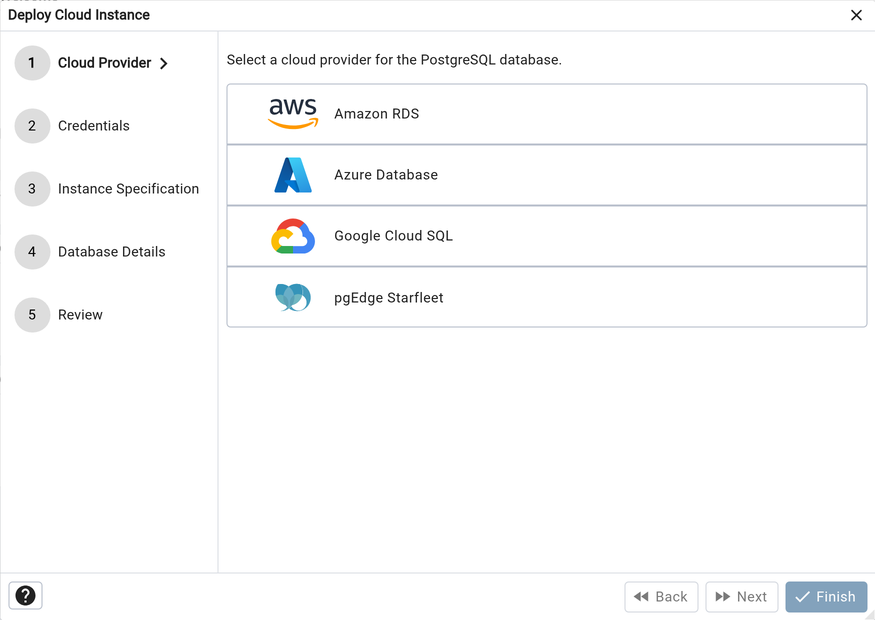
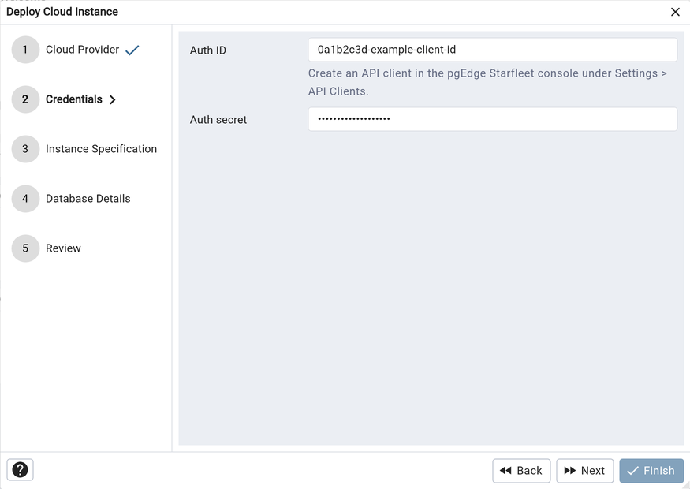
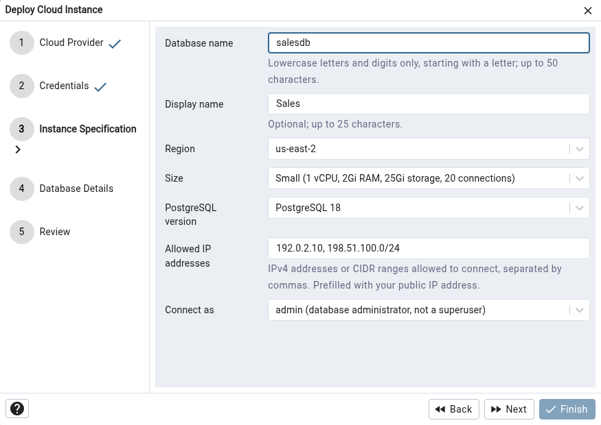
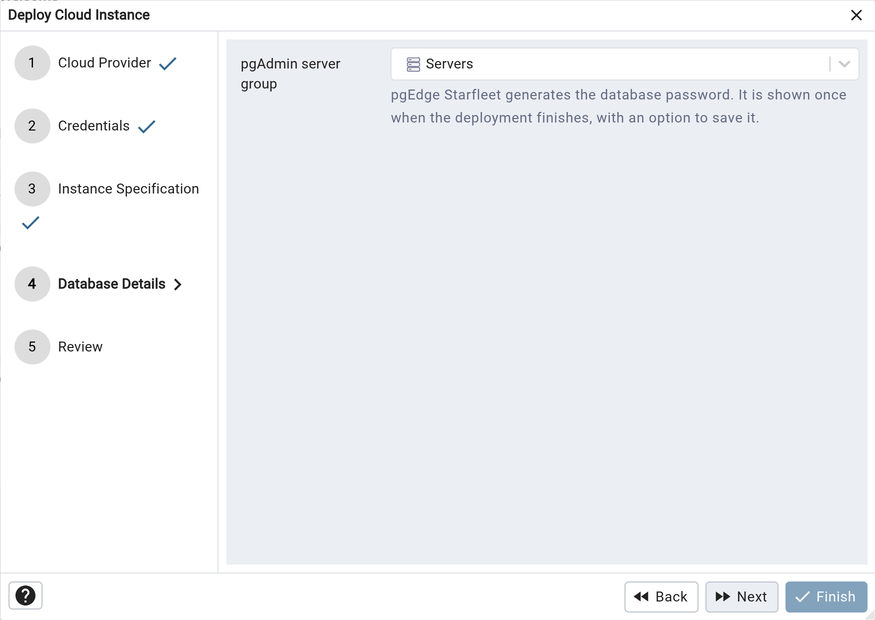
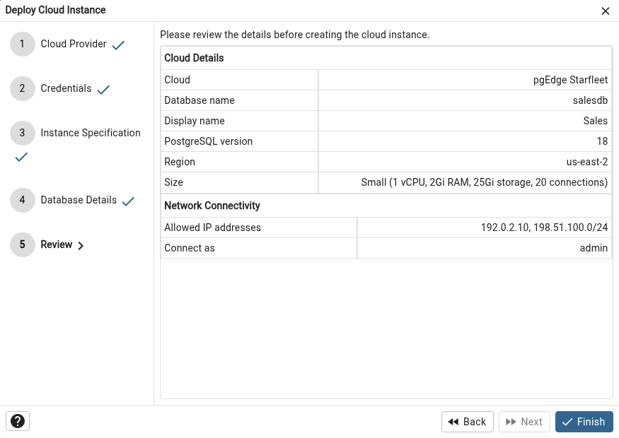
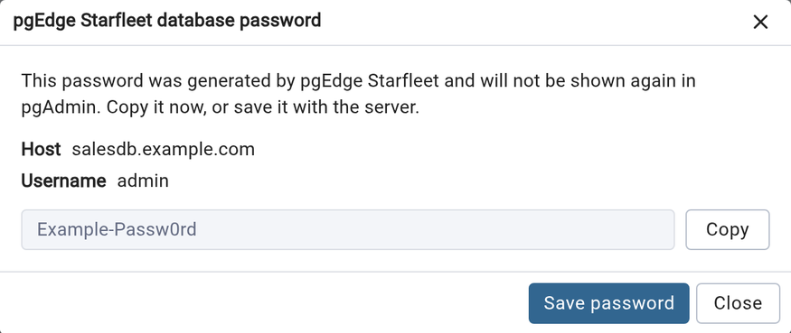

# pgEdge Starfleet Deployment

To deploy a PostgreSQL database on pgEdge Starfleet, follow the steps below. pgAdmin creates a *Managed* database, which Starfleet hosts for you.

Once you launch the tool, select the pgEdge Starfleet option and click on the *Next* button to proceed.

In the Credentials step, enter the *Auth ID* and *Auth secret* of a Starfleet API client. pgAdmin checks them with Starfleet when you click *Next*.

!!! note

    Create the API client in the pgEdge Starfleet console, under *Settings > API Clients*. The Auth secret is shown only when the client is created, so keep a copy of it. See the [pgEdge Starfleet documentation](https://docs.pgedge.com/pgedge-starfleet/) for details.

Use the fields from the Instance Specification step to specify the database details.

- Use the *Database name* field to name the database. The name may contain
    lowercase letters and digits only, must start with a letter, and can be up
    to 50 characters long.

- Use the *Display name* field to optionally set a friendlier name, up to 25
    characters long.

- Select the location to deploy the database to from the *Region* field.

- Use the *Size* field to select the size of the database.

- Use the *PostgreSQL version* field to select the PostgreSQL version.

- Use the *Allowed IP addresses* field to list the IPv4 addresses or CIDR
    ranges that may connect to the database, separated by commas. The field is
    prefilled with your public IP address. At least one and at most 50 entries
    are required; IPv6 addresses are not accepted. Without a matching entry the
    database will not accept connections from pgAdmin.

- Use the *Connect as* field to choose whether pgAdmin connects as *admin*
    (the database administrator, which is not a superuser) or *app* (an
    application user).

In the Database Details step, use the *pgAdmin server group* field to select the server group the new server will be registered in.

Finally, review the summary in the Review step and click *Finish* to start the deployment. The progress of the deployment is shown in the same way as for the other cloud providers, and the new server is added to the *Object Explorer* when the database is available. pgAdmin connects with *sslmode* set to *require* and *gssencmode* set to *disable*.

If the deployment fails after the database has been created, for example because pgEdge Starfleet reports it as failed or it does not become available within 30 minutes, pgAdmin removes the server from the *Object Explorer* but does not delete the database. Check the pgEdge Starfleet console, and delete the database there if it is not needed.

pgEdge Starfleet generates the database password. When the deployment finishes, pgAdmin shows it once in the *pgEdge Starfleet database password* dialog, together with the host and user name.

- Use the *Copy* button to copy the password to the clipboard.

- Use the *Save password* button to save the password with the server. This
    button is only shown if saving passwords is permitted by the
    [ALLOW_SAVE_PASSWORD](../../getting-started/deployment/config_py.md#config_py) setting.

The password is not shown again in pgAdmin after the dialog is closed. If you lose it, reset it from the pgEdge Starfleet console.

!!! note

    pgAdmin contacts the Starfleet API at the address given by the *STARFLEET_API_URL* configuration setting, which defaults to *https://api.pgedge.com*. The address must use HTTPS.
